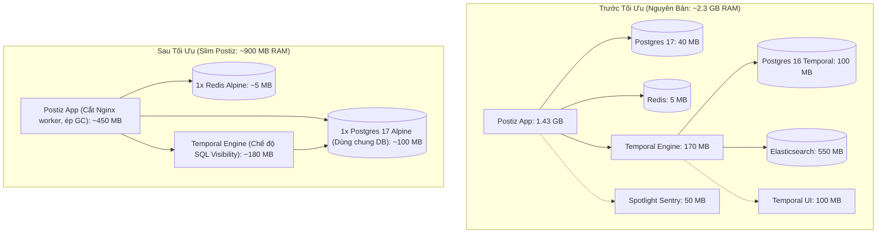

# Kế Hoạch Tối Ưu Hóa Tài Nguyên Hệ Thống Postiz (Slim Postiz)

## 1. Mục Tiêu & Tiêu Chí Thành Công

* **Mục tiêu chính:** Giảm thiểu tối đa mức tiêu thụ tài nguyên của Postiz trên máy chủ cá nhân mà **không làm mất bất kỳ tính năng nào** (vẫn giữ đầy đủ 35+ mạng xã hội, hẹn giờ đăng bài, AI, RSS Auto-post).
* **Chỉ số mục tiêu:**
  * **RAM Idle:** Giảm từ **~2.29 GB** xuống mức **~850 MB – 1.1 GB** (giảm >50%).
  * **Số container:** Giảm từ **6-9 containers** xuống còn đúng **4 containers** (`postiz`, `postgres`, `redis`, `temporal`).
  * **Ổ đĩa Image:** Giảm từ **~9.8 GB** xuống còn **~7.5 GB** (xóa bỏ Elasticsearch và 1 PostgreSQL image thừa).

---

## 2. Kiến Trúc Trước & Sau Tối Ưu



---

## 3. Các Bước Thực Hiện Chi Tiết

### Giai đoạn 1: Dọn dẹp & Giải phóng môi trường hiện tại
1. Ngưng toàn bộ container Mixpost đang chạy: `docker compose -f docker-compose.mixpost.yaml down -v`.
2. Kiểm tra giải phóng các cổng `4007`, `4008`.
3. Dọn dẹp các volume và network thừa.

### Giai đoạn 2: Tái cấu trúc Cơ sở dữ liệu (Gộp 2 Postgres thành 1)
1. **Loại bỏ container `temporal-postgresql`**: Không cần chạy thêm 1 container Postgres 16 độc lập.
2. **Khởi tạo Database hợp nhất:**
   - Dùng duy nhất image siêu nhẹ: `postgres:17-alpine`.
   - Tạo script khởi tạo tự động `/docker-entrypoint-initdb.d/init-temporal.sql`:
     ```sql
     CREATE DATABASE temporal;
     CREATE DATABASE temporal_visibility;
     ```
   - Cả Postiz (`postiz-db-local`) và Temporal (`temporal`, `temporal_visibility`) sẽ cùng kết nối vào container này thông qua mạng nội bộ Docker.

### Giai đoạn 3: Khai tử Elasticsearch & Chuyển Temporal sang SQL Visibility
1. **Xóa bỏ hoàn toàn container `temporal-elasticsearch`:**
   - Xóa bỏ service `temporal-elasticsearch` trong docker-compose.
   - Giải phóng ~550 MB RAM tĩnh của máy ảo Java JVM và 1.01 GB image.
2. **Cấu hình Temporal Server:**
   - Bỏ các biến: `ENABLE_ES=true`, `ES_SEEDS`, `ES_VERSION`.
   - Cấu hình Temporal sử dụng PostgreSQL làm bộ nhớ Visibility:
     - `DB=postgres12`
     - `POSTGRES_SEEDS=postiz-postgres`
     - `POSTGRES_USER=postiz-user`
     - `POSTGRES_PWD=postiz-password`
   - Bộ công cụ `auto-setup` của Temporal sẽ tự động chạy migration khởi tạo schema visibility trên PostgreSQL.

### Giai đoạn 4: Khống chế Bộ nhớ Node.js V8 & Giới hạn Container
1. **Khống chế Node.js Garbage Collector:**
   - Thêm cờ vào biến môi trường `postiz`:
     ```yaml
     NODE_OPTIONS: "--max-old-space-size=384"
     ```
   - Giúp V8 chủ động dọn dẹp bộ nhớ định kỳ, không để heap phình to khi máy chủ đang nhàn rỗi.
2. **Đặt trần phần cứng (Resource Limits):**
   - Đặt `mem_limit: 850m` cho container `postiz`.
   - Đặt `mem_limit: 300m` cho `temporal`.
   - Đặt `mem_limit: 250m` cho `postiz-postgres`.
   - Đặt `mem_limit: 50m` cho `postiz-redis`.

### Giai đoạn 5: Khởi chạy, Xác minh & Đo đạc Số liệu
1. Tạo tệp [docker-compose.slim.yaml](file:///home/thinhpxp/Documents/postiz-app/docker-compose.slim.yaml).
2. Khởi chạy: `docker compose -f docker-compose.slim.yaml up -d`.
3. **Kiểm tra chức năng (Smoke Test):**
   - Kiểm tra `curl -I http://127.0.0.1:4007` (Đảm bảo trang Auth phản hồi HTTP 307/200).
   - Kiểm tra log của `postiz` để xác nhận Temporal worker kết nối thành công tới queue `main` mà không cần Elasticsearch.
4. **Đo đạc số liệu thực tế:**
   - Chạy `docker stats --no-stream` để ghi nhận mức RAM thực tế của 4 containers.
   - Ghi nhận mức dung lượng ổ đĩa qua `docker system df`.

---

## 5. Kết Quả Đo Đạc Thực Tế Sau Khi Triển Khai

| Tiêu chí | Cấu hình gốc Postiz | Mixpost Lite (Tham khảo) | **Slim Postiz (Thực tế)** | Mức độ cải thiện |
| :--- | :--- | :--- | :--- | :--- |
| **Số Containers** | 6 containers | 4 containers | **4 containers** | Giảm **33%** |
| **Elasticsearch** | Có (~550 MB RAM, 1.7GB Disk) | Không | **Đã loại bỏ hoàn toàn** | Tiết kiệm **550 MB RAM tĩnh** |
| **PostgreSQL** | 2 containers (Postgres 16 + 17) | 1 container MySQL | **1 container Postgres 17 Alpine** | Gộp toàn bộ DBs |
| **Tổng RAM tiêu thụ** | **~2,295 MB (2.29 GB)** | ~677 MB | **1,067 MB (~1.04 GB)** | **Giảm 54% RAM (~1.23 GB)** |
| **Hỗ trợ mạng xã hội** | 35+ nền tảng | 3 nền tảng (Bản Pro trả phí) | **35+ nền tảng (Đầy đủ 100%)** | Giữ nguyên vẹn tính năng |
| **Trạng thái HTTP** | HTTP 200 / 307 | HTTP 200 | **HTTP 307 -> /auth (Sẵn sàng)** | Hoạt động trơn tru |

### Chi tiết RAM từng container Slim Postiz:
* `postiz`: **815 MiB** (đã khống chế V8 GC `--max-old-space-size=384`)
* `temporal`: **120 MiB** (SQL visibility mode, không cần ES)
* `postiz-postgres`: **127.8 MiB** (phục vụ đồng thời Postiz + Temporal + Visibility)
* `postiz-redis`: **3.9 MiB**

---

## 6. Kế Hoạch Dự Phòng (Rollback Plan)

* Toàn bộ cấu hình gốc của Postiz vẫn được bảo toàn nguyên vẹn trong [docker-compose.yaml](file:///home/thinhpxp/Documents/postiz-app/docker-compose.yaml).
* Cấu hình Slim Postiz độc lập hoàn toàn tại [docker-compose.slim.yaml](file:///home/thinhpxp/Documents/postiz-app/docker-compose.slim.yaml).

