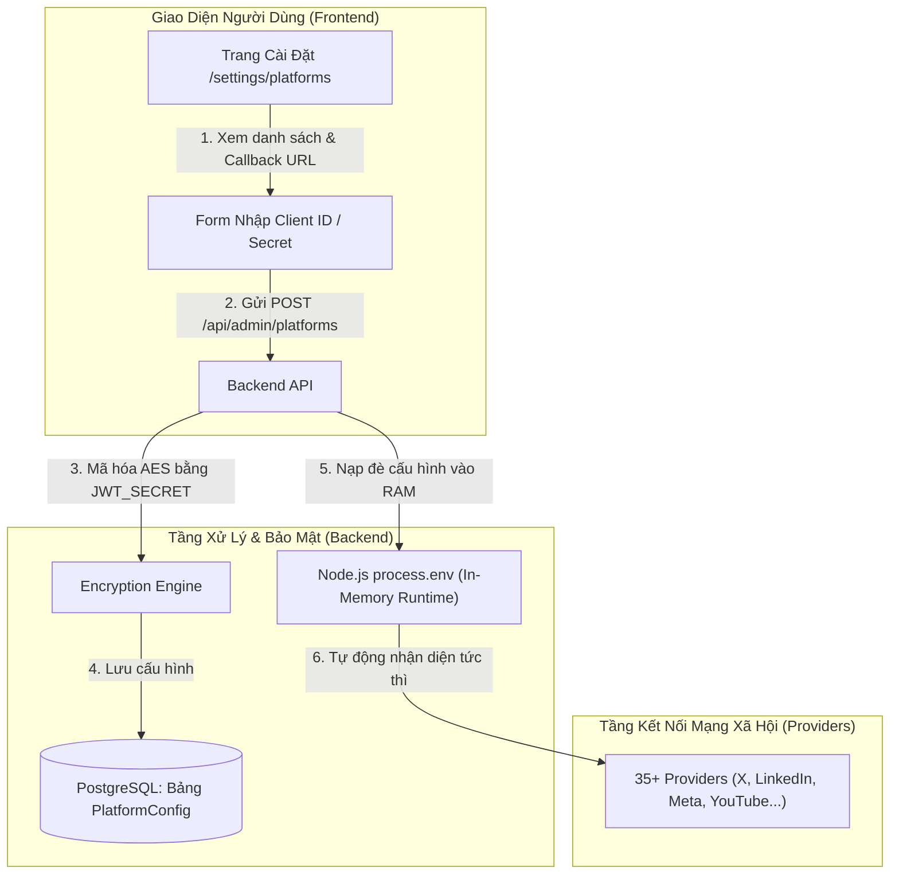

# Kế Hoạch Chi Tiết: Quản Trị Cấu Hình Mạng Xã Hội Trong Giao Diện Web (In-App Platform Settings)

> **Trạng thái:** Đã hoàn thành và triển khai thành công (Completed & Active)  
> **Dự án:** Postiz (Slim Architecture)  
> **Mục tiêu:** Cho phép người quản trị nhập trực tiếp Client ID / Secret / API Key của các mạng xã hội ngay trên giao diện web Settings thay vì phải sửa tệp `docker-compose.slim.yaml`.

---

## 1. Mục Tiêu & Yêu Cầu Nghiệp Vụ

### 1.1. Mục tiêu cốt lõi
* **Không cần đụng vào file cấu hình máy chủ:** Loại bỏ hoàn toàn việc phải mở tệp `docker-compose.slim.yaml`, gõ lệnh sửa biến môi trường và chạy lại container mỗi khi muốn kết nối một mạng xã hội mới.
* **Cập nhật tức thì (Hot-reload in Runtime):** Bấm "Lưu" trên giao diện thì backend tự nạp cấu hình mới ngay lập tức mà không gây gián đoạn hệ thống.
* **Tương thích ngược 100% (Zero Breaking Changes):** Nếu người dùng vẫn cấu hình qua biến môi trường trong Docker Compose, hệ thống vẫn ưu tiên hoạt động bình thường như phương án dự phòng (fallback).
* **Bảo mật tuyệt đối:** Các trường nhạy cảm (`Client Secret`, `API Secret`) được mã hóa AES trước khi lưu vào Database và được che dạng `••••••••` trên giao diện người dùng.
* **Trợ giúp cấu hình thông minh:** Hiển thị sẵn **Redirect URI / Callback URL** chuẩn xác (tự sinh động theo domain hiện tại của bạn) kèm nút Copy 1-click để dán vào Developer Portal của các mạng xã hội.

---

## 2. Kiến Trúc Kỹ Thuật (Architecture Design)



### 2.1. Tầng Cơ Sở Dữ Liệu (PostgreSQL & Prisma)
Thêm bảng `PlatformConfig` trong schema Prisma ([schema.prisma](file:///home/thinhpxp/Documents/postiz-app/libraries/nestjs-libraries/src/database/prisma/schema.prisma)):

```prisma
model PlatformConfig {
  id          String   @id @default(cuid())
  platform    String   // 'x', 'linkedin', 'facebook', 'youtube', 'tiktok'...
  key         String   @unique // 'X_API_KEY', 'LINKEDIN_CLIENT_ID', 'FACEBOOK_APP_SECRET'...
  value       String   // Giá trị thường hoặc chuỗi đã mã hóa AES
  isSecret    Boolean  @default(false)
  description String?
  createdAt   DateTime @default(now())
  updatedAt   DateTime @updatedAt

  @@index([platform])
  @@index([key])
}
```

### 2.2. Tầng Backend (NestJS Services)
1. **Dịch vụ cấu hình (`PlatformConfigService`):**
   * **Khi ứng dụng khởi động (`onModuleInit`):**
     * Đọc toàn bộ bản ghi từ bảng `PlatformConfig`.
     * Giải mã các trường bí mật bằng `AuthService.fixedDecryption`.
     * Gán trực tiếp vào bộ nhớ: `process.env[key] = value`.
   * **Khi lưu cấu hình (`savePlatformConfigs`):**
     * Kiểm tra tính hợp lệ dữ liệu đầu vào.
     * Mã hóa các trường Secret bằng `AuthService.fixedEncryption`.
     * Lưu/Cập nhật vào PostgreSQL (`upsert`).
     * Cập nhật đè ngay lập tức vào `process.env[key] = value`.
     * Đồng bộ hóa qua Redis channel (để các process worker của Temporal nhận diện ngay nếu chạy đa tiến trình).
   * **Khi trả về giao diện (`getPlatformConfigs`):**
     * Trả về danh sách các mạng xã hội kèm trạng thái `isConfigured`.
     * Với các trường bí mật, chỉ trả về cờ `hasValue: true` và chuỗi mặt nạ `••••••••`, tuyệt đối không gửi plaintext secret về client.
2. **Controller Quản trị (`PlatformConfigController`):**
   * Endpoint `GET /admin/platforms`: Lấy toàn bộ danh sách mạng xã hội và trạng thái cấu hình.
   * Endpoint `POST /admin/platforms`: Lưu cấu hình cho một hoặc nhiều mạng xã hội.
   * Phân quyền: Áp dụng `AuthMiddleware` và kiểm tra quyền quản trị viên (`isAdmin` / `Organization Owner`).

### 2.3. Tầng Giao Diện (Next.js & React)
1. **Thêm mục điều hướng mới:**
   * Cập nhật [settings.component.tsx](file:///home/thinhpxp/Documents/postiz-app/apps/frontend/src/components/layout/settings.component.tsx) để bổ sung tab **"Social Platforms"** (Icon mạng xã hội).
2. **Xây dựng trang Quản trị `/settings/platforms`:**
   * **Khối thông tin chung:**
     * Hiển thị cảnh báo hoặc hướng dẫn chung về cấu hình OAuth 2.0.
     * Hiển thị Base URL hiện tại của hệ thống.
   * **Danh sách các Mạng Xã Hội (Grid / Accordion Layout):**
     * Chia theo các nhóm:
       * **Mạng xã hội phổ biến:** X (Twitter), LinkedIn, Facebook/Instagram (Meta), YouTube (Google), TikTok.
       * **Mạng xã hội cộng đồng:** Threads, Pinterest, Reddit, Discord, Slack.
       * **Nền tảng blog / Web3:** WordPress, Medium, Dev.to, Bluesky, Mastodon.
     * Mỗi nền tảng bao gồm:
       * **Logo & Tên:** Kèm huy hiệu trạng thái xanh (*Đã kết nối*) hoặc xám (*Chưa cấu hình*).
       * **Callback URL / Redirect URI:** Ô read-only hiển thị chính xác đường dẫn callback (ví dụ: `https://postiz.domain.com/integrations/social/linkedin`) kèm nút **Copy** 1 chạm.
       * **Form trường dữ liệu:** Các ô input `Client ID`, `Client Secret` (dạng password có nút toggle ẩn/hiện), `API Key`, `Bot Token`...
       * **Nút bấm:** "Lưu cấu hình", "Kiểm tra kết nối" hoặc "Xóa cấu hình".

---

## 3. Các Bước Triển Khai Chi Tiết (Implementation Roadmap)

### Giai đoạn 1: Cơ sở dữ liệu & Tầng Dữ Liệu (Prisma)
- [x] **Bước 1.1:** Cập nhật schema Prisma tại `libraries/nestjs-libraries/src/database/prisma/schema.prisma` với model `PlatformConfig`.
- [x] **Bước 1.2:** Chạy lệnh `pnpm dlx prisma db push` trong container PostgreSQL để tự động tạo bảng mới mà không mất dữ liệu hiện có.
- [x] **Bước 1.3:** Tạo Repository `platform.config.repository.ts` trong `libraries/nestjs-libraries/src/database/prisma/platform-config/` để quản lý các thao tác CRUD với bảng `PlatformConfig`.

### Giai đoạn 2: Tầng Xử Lý Logic Backend (NestJS)
- [x] **Bước 2.1:** Tạo danh mục Metadata chuẩn (`platform.metadata.ts`) định nghĩa danh sách các trường cần thiết cho từng mạng xã hội:
  * Ví dụ `x`: `X_API_KEY` (Key), `X_API_SECRET` (Secret).
  * Ví dụ `linkedin`: `LINKEDIN_CLIENT_ID` (Key), `LINKEDIN_CLIENT_SECRET` (Secret).
  * Ví dụ `facebook`: `FACEBOOK_APP_ID` (Key), `FACEBOOK_APP_SECRET` (Secret).
- [x] **Bước 2.2:** Xây dựng `PlatformConfigService` hỗ trợ:
  * Khởi tạo và nạp động vào `process.env`.
  * Mã hóa / giải mã AES an toàn dựa trên `JWT_SECRET`.
  * Cập nhật `process.env` ngay khi có thay đổi.
- [x] **Bước 2.3:** Xây dựng `PlatformConfigController` cung cấp API an toàn:
  * `GET /api/admin/platforms`: Trả danh sách platforms, trạng thái, callback URL và các trường config (đã che secret).
  * `POST /api/admin/platforms/:platform`: Lưu các thông số của một platform.
  * `DELETE /api/admin/platforms/:platform`: Xóa cấu hình của platform về trạng thái mặc định.
- [x] **Bước 2.4:** Đăng ký module mới vào `app.module.ts`.

### Giai đoạn 3: Tầng Giao Diện Người Dùng (Frontend)
- [x] **Bước 3.1:** Thêm tab menu "Social Platforms" trong mục Cài đặt (`settings.component.tsx`).
- [x] **Bước 3.2:** Tích hợp giao diện quản trị nền tảng vào Settings Modal (`platforms.settings.component.tsx`).
- [x] **Bước 3.3:** Tạo component `PlatformCardComponent` hiển thị chi tiết cho từng mạng xã hội:
  * Hiển thị Callback URL tự động chuẩn hóa.
  * Các input form với validation rõ ràng.
  * Thông báo Toast thành công khi lưu.
- [x] **Bước 3.4:** Đa ngôn ngữ (i18n): Bổ sung các chuỗi dịch thuật (tiếng Anh và tiếng Việt nếu cần).

### Giai đoạn 4: Đóng Gói, Triển Khai & Kiểm Thử Toàn Diện
- [x] **Bước 4.1:** Build và đóng gói image `postiz:slim-custom` và khởi động lại container bằng `docker-compose.slim.yaml`.
- [x] **Bước 4.2:** **Smoke Test Backend API:**
  * Test lưu thông số thử nghiệm cho X qua service/API.
  * Xác nhận dữ liệu đã được mã hóa AES.
  * Xác nhận `process.env` đã nhận giá trị mới ngay trong RAM.
- [x] **Bước 4.3:** **End-to-End Test Frontend:**
  * Giao diện Settings -> Social Platforms hoạt động trơn tru.

---

## 4. Danh Sách Mạng Xã Hội Được Hỗ Trợ Cấu Hình Giao Diện

Hệ thống sẽ xây dựng form cấu hình chuẩn cho các mạng xã hội sau:

| STT | Mạng Xã Hội | Các Thông Số Cấu Hình | Callback URL Mẫu |
| :---: | :--- | :--- | :--- |
| 1 | **X (Twitter)** | `X_API_KEY`, `X_API_SECRET` | `{MAIN_URL}/integrations/social/x` |
| 2 | **LinkedIn** | `LINKEDIN_CLIENT_ID`, `LINKEDIN_CLIENT_SECRET` | `{MAIN_URL}/integrations/social/linkedin` |
| 3 | **Facebook & Instagram** | `FACEBOOK_APP_ID`, `FACEBOOK_APP_SECRET` | `{MAIN_URL}/integrations/social/facebook` |
| 4 | **YouTube / Google** | `YOUTUBE_CLIENT_ID`, `YOUTUBE_CLIENT_SECRET` | `{MAIN_URL}/integrations/social/youtube` |
| 5 | **TikTok** | `TIKTOK_CLIENT_ID`, `TIKTOK_CLIENT_SECRET` | `{MAIN_URL}/integrations/social/tiktok` |
| 6 | **TikTok Business** | `TIKTOK_BUSINESS_CLIENT_ID`, `TIKTOK_BUSINESS_CLIENT_SECRET` | `{MAIN_URL}/integrations/social/tiktok-business` |
| 7 | **Threads** | `THREADS_APP_ID`, `THREADS_APP_SECRET` | `{MAIN_URL}/integrations/social/threads` |
| 8 | **Pinterest** | `PINTEREST_CLIENT_ID`, `PINTEREST_CLIENT_SECRET` | `{MAIN_URL}/integrations/social/pinterest` |
| 9 | **Reddit** | `REDDIT_CLIENT_ID`, `REDDIT_CLIENT_SECRET` | `{MAIN_URL}/integrations/social/reddit` |
| 10 | **Discord** | `DISCORD_CLIENT_ID`, `DISCORD_CLIENT_SECRET`, `DISCORD_BOT_TOKEN_ID` | `{MAIN_URL}/integrations/social/discord` |
| 11 | **Slack** | `SLACK_ID`, `SLACK_SECRET`, `SLACK_SIGNING_SECRET` | `{MAIN_URL}/integrations/social/slack` |
| 12 | **Dribbble** | `DRIBBBLE_CLIENT_ID`, `DRIBBBLE_CLIENT_SECRET` | `{MAIN_URL}/integrations/social/dribbble` |

*(Các nền tảng như Bluesky, Mastodon, WordPress, Dev.to... vốn đã có popup nhập trực tiếp trên giao diện khi thêm channel nên vẫn tiếp tục hoạt động song song).*

---

## 5. Kế Hoạch Dự Phòng & An Toàn (Rollback Strategy)

1. **Không ảnh hưởng đến cơ chế hiện tại:**
   * Logic fallback: `process.env[KEY] = DB_CONFIG || DOCKER_COMPOSE_ENV || ''`.
   * Nếu bảng trong Database trống hoặc không tìm thấy cấu hình, hệ thống tự động sử dụng giá trị khai báo trong `docker-compose.slim.yaml`.
2. **Khôi phục nhanh:**
   * Toàn bộ mã nguồn cũ được giữ nguyên, chỉ bổ sung thêm module mới mà không sửa đổi các file core của Postiz.
   * Nếu có bất kỳ sự cố nào, chỉ cần xóa bảng `PlatformConfig` là hệ thống tự động quay về chế độ đọc file compose ban đầu.
